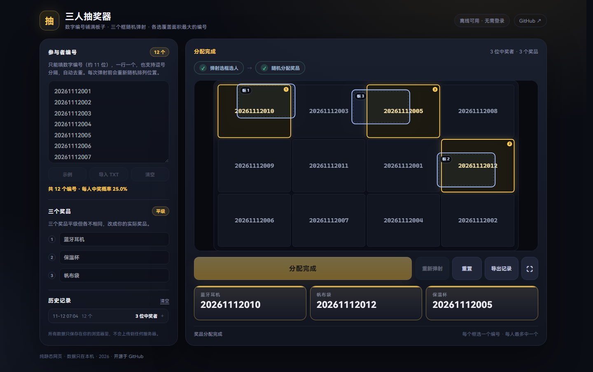

# 三人抽奖器 · 选框弹射版

> 这是 **`easter-egg` 搞怪分支**，当前 GitHub Pages 线上地址已指向这个分支。

> 把 **11 位左右的数字编号**平铺在板子上，三个悬浮选框带着不同的摩擦力随机弹射、互相碰撞且不重叠；停下后每个框选覆盖面积最大的编号，再把三个不同奖品随机分配给这三位中奖者。**每人最多中一个**。选框大小、格子间距、空位处理都可以调。



**线上地址：** https://lanyangyin.github.io/three-prize-lottery/

## 玩法

1. 左侧填写参与者**数字编号**（约 11 位，一行一个或用逗号分隔，自动去重）；
2. 填三个平级但内容不同的奖品，例如：蓝牙耳机、保温杯、帆布袋；
3. 点 **开始弹射** 或按 `空格`：
   - 三个框从**当前可见位置**直接出发，不会瞬移到随机起点；
   - 每次弹射前，编号在板子上的位置会重新随机排列；
   - 三个选框以随机方向弹出，各自摩擦力不同，会撞墙、也会互相碰撞，但不会重叠；
4. 三个框都停下后，每个框各自选中覆盖面积最大的编号；
   - 如果两个框同时选中同一个编号，则在“三个框对应三个不同编号”的前提下，选总覆盖面积最大的一组；
   - 如果某个框完全没盖住任何编号（停在空位）：默认要求重新弹射，也可以在设置里改成“选最近的编号”；
5. 点 **随机分配奖品**，三个奖品随机分给三位中奖者，每人一个；
6. 结果自动写入历史记录，可导出 TXT。

> 程序至少需要 4 个编号（3 位中奖者 + 1 个余量）；实际活动常用 5~50 个。
>
> 如果中奖者不在场：在分配奖品前点 **重新弹射** 重抽三位；已经分配奖品后，点 **重置** 开始新一轮。

## 选框与格子设置

左侧「选框与格子」可以调：

| 设置 | 范围 | 默认 |
| --- | --- | --- |
| 选框大小 | 180~420（宽），高度固定为宽度的 60% | 300 × 180 |
| 格子间距 | 0~24 | 6px |
| 空位处理 | 重新弹射 / 选最近编号 | 重新弹射 |

- **空位**指框停下时完全没有盖住任何编号；
- 「重新弹射」时空位框会变红并提示，需要重新点弹射；「选最近编号」会自动给空位框补一个最近的编号；
- 调整后立即生效；抽奖开始后这些设置会锁定，需要重置后才能继续调整。

## 🥚 搞怪分支彩蛋

- 顶部和底部的 GitHub 链接默认隐藏，**按住 `Ctrl`** 才显示，松开立即隐藏；
- 点击页面空白处（让输入框失焦），依次按 `↑ ↑ ↓ ↓ ← → ← → A B A B`；
- 会弹出「隐藏设置」输入框：
  - **只记录内定，不会立刻开奖**；
  - 参与者编号必填，必须在当前名单里；
  - 奖品序号填 1 / 2 / 3，留空则该编号的奖品每次随机；
  - 保存后，之后**每次正常弹射**都会让该编号成为三位中奖者之一，不需要重新填写；另外两位按另外两个框的正常结果产生；
  - **不改地板、不换编号**：每次弹射前先在后台模拟多条弹射路径，挑一条会撞墙、撞框几次且最后目标格成为某个框最大覆盖格的路径，再把这条轨迹回放出来；
  - 回放路径不是直线，能看到多次墙壁和选框之间的碰撞；最终覆盖关系是真实计算出来的，不会出现“框里更大的格子没被选中”；
  - 不追求每把都“差一点”：大部分是正常压中，只有偶尔才会挑到险胜的路径；
  - 如果设置后这个编号不在当前名单里，不会报错；这次及之后的弹射都会正常随机，直到该编号重新出现在名单里或点「清除作弊」；
  - 设置保存在浏览器本地，刷新后仍然生效，直到点「清除作弊」；
  - 清除只影响后续弹射，已经出来的当前结果不会变。


本地预览这个分支：

```bash
git checkout easter-egg
python -m http.server 8765
```

## 公平性

- 每次弹射前，所有编号在板子上的位置都会用无偏随机做一次洗牌；
- 三个选框的方向、速度以及摩擦力分配都是随机的（起点就是用户看到的当前位置，不会再瞬移）；
- 因此每个编号对三个框来说是对称的，每人被选中的概率约为 **3 ÷ 总编号数**（5 个编号 60%，10 个 30%，50 个 6%）；
- 三个框最终必须落到不同编号上，不会出现一个人拿两个奖品；
- 第二步的奖品分配使用 Fisher-Yates 无偏洗牌，每个奖品各分配一次。

## 操作

| 操作 | 说明 |
| --- | --- |
| **开始弹射** / `空格` | 校验编号和奖品，锁定输入，开始第一步 |
| **随机分配奖品** | 三位中奖者选出后出现，完成第二步 |
| **重新弹射** | 分配奖品前可用；空位重抽时也可用，从框当前位置重新弹射 |
| **重置** | 清空本轮，开始新的一轮（历史记录保留） |
| **导出记录** | 分配完成后可预览、复制或下载 TXT |
| ⛶ / `F11` | 全屏投屏，`Esc` 退出 |

## 文件结构

```text
index.html          页面
assets/styles.css   样式
assets/core.js      抽奖状态、数字编号校验、覆盖面积选择算法
assets/board.js     编号板绘制、选框物理模拟与碰撞
assets/app.js       界面交互、本地存储、奖品分配
assets/favicon.svg  图标
tests/core.test.js  Node 单元测试
```

## 开发

```bash
node --test tests/core.test.js
```

测试覆盖数字编号校验、选框覆盖面积选择、冲突去重、空位重抽/选最近、两步抽奖状态、奖品随机分配、存档恢复与记录格式。

数据只保存在浏览器本地，不会上传到任何服务器。
